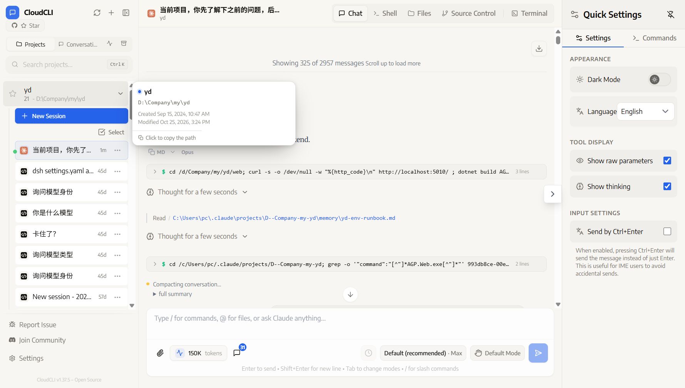
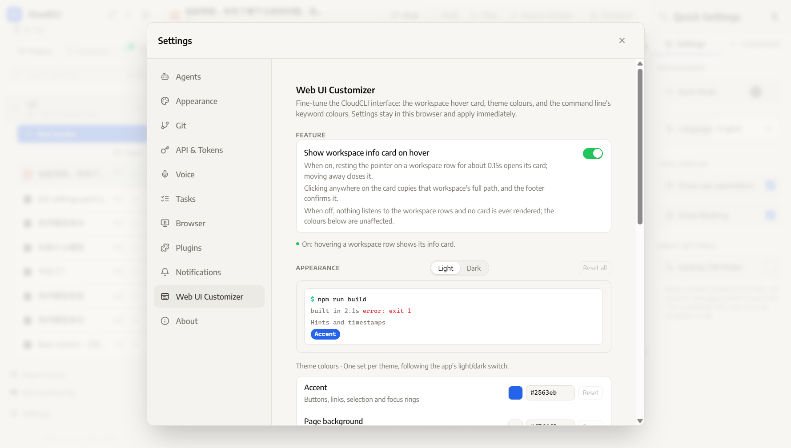
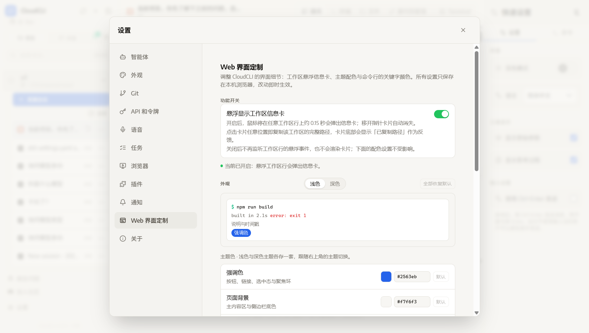

# Web 界面定制（web-ui-customizer）

**简体中文** | [English](README.en.md)

CloudCLI 插件：给 Web 界面加两件事——**工作区悬浮信息卡**（含一键复制路径）与**主题/命令行配色**。全部设置默认关闭或默认沿用原生配色，装上去不改任何现有行为。

插件最初叫 `workspace-info-card`，加入配色能力后改名。旧的 `localStorage` 键会被读一次，所以早期打开过悬浮卡的人升级后开关状态不会丢。

## 截图

悬浮工作区行 → 信息卡（点卡片复制路径）：



设置在 **「设置」对话框** 里，「插件」下面多出自己的一页（开关 + 双主题配色 + 实时预览），不占工作区标签页：



插件界面与设置左栏导航项均跟随宿主语言（上图 English，下图简体中文）：



## 功能

### 一、工作区悬浮信息卡

| 能力 | 说明 |
| --- | --- |
| 悬浮显示 | 鼠标停在左侧工作区行上约 0.15 秒弹出，移开自动消失 |
| 卡片内容 | 工作区名称、完整路径、目录创建时间、最近修改时间 |
| 点击复制 | 点卡片任意位置复制完整路径，底部显示「已复制路径」反馈 |
| 开关 | 默认**关闭**；关闭后不再监听工作区行的悬浮事件、也不渲染卡片，配色设置不受影响 |

CloudCLI 原本没有「复制工作区路径」的入口，路径只能从侧边栏被截断的两行文字里看。这个功能补上这件事。

### 二、主题配色（浅色 / 深色各一套）

| 分组 | 可调项 | 说明 |
| --- | --- | --- |
| 主题色 | 强调色、页面背景、卡片与浮层、分割线 | 写入宿主的 CSS 变量（HSL 三元组），并联动派生变量 |
| 字体颜色 | 正文文字、次要文字 | 同时联动 `--card-foreground` / `--popover-foreground` 等 |

强调色会顺带重算 `--primary-foreground`（自动挑可读的黑或白）、`--ring`、导航高光；页面背景会同步 `--nav-glass-bg` 的透明度；卡片色会同步 `--popover`。这样不会出现「只改了一半」的花脸。

### 三、命令行配色

CloudCLI 的命令块（`$ npm run build` / 输出 / 报错）里关键字是写死的 Tailwind 色值，不是变量，所以单独一组按选择器覆盖：

| 可调项 | 对应元素 |
| --- | --- |
| 提示符 `$` | 命令块左侧的 `$` |
| 命令文本 | 被执行的命令本身 |
| 正常输出 | 命令成功时的输出行 |
| 报错输出 | 命令失败时的输出行 |

> 边界：xterm 终端（`Terminal` 标签页）的配色由 xterm 主题对象决定，不走 CSS 变量，**不在这组覆盖范围内**。

### 四、多语言界面

插件的界面文案跟随 **CloudCLI 自己的语言设置**，切语言立刻生效，不用刷新、不用重装：

| 宿主语言 | 插件文案 |
| --- | --- |
| English | English |
| 简体中文 / 繁體中文 | 简体 / 繁體（自动区分 `zh-CN` 与 `zh-TW`） |
| 其他 15 种语言 | 回退到英文（与宿主 `fallbackLng: 'en'` 的策略一致） |

覆盖面是插件里所有**固定文案**：设置页的标题、开关说明、分组名、每个颜色项的名称与提示、预览区、状态行、按钮，以及悬浮卡的标题行、字段名、「已复制路径」反馈和读屏用的 `aria-label`。日期时间按当前语言用 `Intl.DateTimeFormat` 格式化。

设置对话框**左栏的导航项**也跟随语言。那一行由宿主从 `manifest.json` 的单一字符串 `displayName` 渲染，宿主自己无法翻译；插件的常驻层会用 `MutationObserver` 把该文本节点改写成当前语言的名称（`src/nav.ts`），语言切换、对话框重开、React 重渲染都会重新对齐。宿主升级后如果换了渲染结构，这里会安全失效并显示 manifest 原文，不会破坏宿主。

## 为什么需要宿主配合

CloudCLI 上游的插件系统只有一个挂载位：`slot: "tab"`——插件 UI 只在**用户点开它的标签页时**才被 `import()` 进浏览器。而「悬浮卡片」和「全局配色」都要求不打开标签页也生效、「设置项」又不该占一个工作区视图，纯插件做不到。

这个 fork 给宿主加了两种表面（[宿主改动说明](https://github.com/fu827707013/claudecodeui/blob/feat/plugin-resident-mount/docs/plugin-resident-mount.md)）：

| manifest 字段 | 效果 | 本插件用途 |
| --- | --- | --- |
| `"alwaysMount": true` | 应用启动即把 bundle 挂进常驻层（[PluginHostLayer](https://github.com/fu827707013/claudecodeui/blob/feat/plugin-resident-mount/src/modules/plugins/PluginHostLayer.tsx)），与当前打开哪个标签页无关 | 注入配色样式表、运行悬浮卡片 |
| `"slot": "settings"` | 插件 UI 变成「设置」对话框里的一页，左栏导航多一项 | 配置界面 |

同一个 bundle 用 `host.context.surface` 判别自己在哪个表面（`'resident' | 'settings' | 'tab'`），分别渲染卡片或面板。两处是**同一份 bundle 的两个模块实例**，模块作用域不共享，所以靠 `localStorage` + 事件同步。

**装之前先确认宿主支持这两个字段。** 上游 `siteboon/claudecodeui` 的 `validateManifest` 只接受 `ALLOWED_SLOTS = ['tab']`，遇到 `"slot": "settings"` 会直接判为非法清单，安装以 `Invalid manifest: Invalid plugin slot: settings. Must be one of: tab` 失败——不是「装上了但少一页」，而是根本装不上。`alwaysMount` 上游虽然不会拒绝（它只校验必填字段和 slot），但上游也没有常驻层，所以一个 bundle 若只有悬浮卡能力，装到上游等于什么都不做。

所以本插件目前只在上面的 fork 上可用。

## 结构

```
web-ui-customizer/
├── manifest.json          插件清单（slot: settings + alwaysMount: true）
├── package.json           构建脚本与依赖
├── scripts/build.mjs      esbuild 打包（前端 + 后端）
└── src/
    ├── index.ts           入口：按 host.context.surface 分派——常驻区挂卡片，设置页挂面板
    ├── card.ts            悬浮卡片：行定位、显隐延时、点击复制、时间缓存
    ├── nav.ts             设置左栏导航项的多语言改写（宿主只能渲染 manifest 单字符串）
    ├── panel.ts           设置页：开关、主题切换、预览、颜色行
    ├── tokens.ts          可调项定义：每个 token 的宿主默认值、选择器、联动变量
    ├── apply.ts           把设置编译成一张注入的样式表（双主题作用域）
    ├── color.ts           hex ⇄ HSL 三元组、可读前景色、hex 归一化
    ├── clipboard.ts       剪贴板（含 http 页面的 execCommand 回退）
    ├── prefs.ts           设置持久化 + 跨表面变更事件
    ├── server.ts          后端：读目录创建/修改时间
    ├── types.ts           宿主 API 类型
    ├── i18n/              多语言：语言解析、消息表、订阅宿主语言变化
    └── ui/                样式表与内联图标
```

## 开发

```bash
npm install
npm run build      # 产出 dist/index.js 与 dist/server.js
npm run typecheck
npm run dev        # 监听模式
```

## 安装

### 一、在界面里装（推荐）

CloudCLI 的插件安装器只做一件事：`git clone` → 找仓库**根目录**的 `manifest.json` → `npm install --ignore-scripts` → `npm run build`。所以本仓库根目录**就是插件本体**，直接填仓库地址即可：

```
https://github.com/fu827707013/web-ui-customizer
```

打开 **设置 → 插件**，在「从 Git 安装」里粘贴上面这行，等它构建完成 → 重启 CloudCLI → 在 **设置 → Web 界面定制** 里打开开关。

> 安装器不会并行处理「合集仓库」：它只 clone 一次、只看仓库根目录，所以一个仓库放多个插件是装不上的（会报 "Cloned repository does not contain a manifest.json"）。想发多个插件就发多个仓库。

### 二、本地开发装（改代码时用）

```powershell
npm run build
$target = "$env:USERPROFILE\.claude-code-ui\plugins\web-ui-customizer"
New-Item -ItemType Directory -Force $target | Out-Null
# 逐项复制：`Copy-Item -Recurse . $target` 会多套一层 web-ui-customizer\ 目录，
# 宿主按 plugins\<name>\manifest.json 找清单，套一层就扫不到。
Copy-Item -Path manifest.json, package.json, icon.svg -Destination $target -Force
Copy-Item -Path src, scripts, dist -Destination $target -Recurse -Force
```

然后重启 CloudCLI 宿主（插件清单只在启动/刷新插件列表时扫描），在 **设置 → Web 界面定制** 里打开开关即可。

## 实现要点（踩过的坑）

- **一个 bundle，三个表面**。宿主的常驻层与设置页各自 `import()` 一次，模块作用域不共享，所以设置只能走 `localStorage` + `SETTINGS_CHANGED_EVENT` 同步。
- **`slot: "settings"` 后标签页不再出现**。设置页只在它是当前视图时挂载，切走即卸载——插件代码不会停在后台。想同时要「常驻效果」和「设置界面」，就同时写 `alwaysMount: true` 与 `slot: "settings"`，用 `surface` 分流。
- **颜色必须写成样式表，不能写成内联 `style`**。宿主浅色在 `:root`、深色在 `.dark`，内联声明没法按主题分开，会把一套颜色钉死到两个主题上。注入的样式表可以同时持有 `html:not(.dark)` 与 `html.dark` 两块，切主题无需重新应用。
- **规则要带 `!important`**。选择器特异性够（0,1,1 vs 0,1,0），但 dev server 每次热更新都会把 Tailwind 样式表重新插到 `<head>` 末尾，宿主的代码高亮主题也是渲染时才注入——同样特异性、出现在后面的规则会赢。自定义属性和 `color` 都加 `!important` 才能稳住这个竞争。
- **命令块没有 data 属性**，只能按组件写死的 utility class 匹配，且 class 名里带 `/`，用 `[class~="group/cmd"]` 才能避开选择器转义。
- **行定位靠宿主的数据属性**：`data-cloudcli-project-path` / `data-cloudcli-project-name`，两种侧边栏布局的行上都有。插件用 `document` 级委托监听，后挂载的行也能命中。
- **卡片挂在 `document.body` 而不是自己的容器里**。常驻层的容器是零尺寸的，塞进去的东西看不见。
- **读时间走宿主 RPC 代理**，不是裸 `fetch`：`/api/plugins/*` 需要登录态，裸请求会 401。
- **创建时间来自文件系统**，由插件后端 `fs.stat` 得到；有些文件系统不报 creation time，此时卡片少显示一行，而不是显示 1970。
- **插件拿不到宿主的 `t()`**。插件 bundle 是动态 `import()` 进来的独立模块，没有 React 上下文，也拿不到宿主的 i18n 实例。插件的做法是读宿主写在 `localStorage` 里的语言镜像（`user-preferences` → `userLanguage`），再监听宿主的 `user-preferences:changed` 事件做实时切换——这条路不依赖宿主提供任何新 API。
- **语言回退顺序是 `en` 而不是中文**。`resolveLocale()` 把 `zh-Hans` 归到 `zh-CN`、`zh-Hant`/`zh-TW`/`zh-HK`/`zh-MO` 归到 `zh-TW`，其余一律归到 `en`（含 `navigator.language` 不参与判断，免得和宿主设置打架）。`messages.ts` 里 `en` 是基准表，`MessageKey = keyof typeof en`，漏翻译会直接类型报错而不是运行时露中文。
- **`package.json` 不能带 BOM**。宿主用它判断有没有 `build` 脚本，读的是 `JSON.parse(fs.readFileSync(..., 'utf-8'))`——带 BOM 会解析失败，宿主把这当成「没有构建脚本」，跳过构建仍然报安装成功，结果是插件装上了却没有 `dist/`，前端与后端全都不工作。Windows 编辑器很容易在存盘时自动加 BOM，本仓库的工作区与 git blob 都是无 BOM 的。
